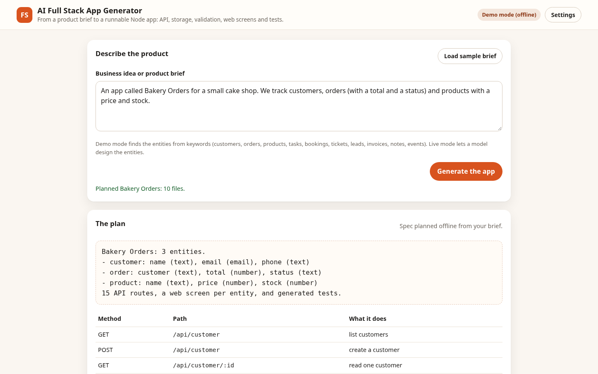

# AI Full Stack App Generator

Describe a business or product and get a runnable Node app: a JSON API with validation and CRUD routes, in-memory storage, a web screen per entity, and generated tests. The generated project has no dependencies and passes its own tests. Demo mode plans from keywords offline; live mode lets an OpenAI-compatible model design the entities. Every generated file is written from one spec.



## Features

- Reads a plain-language brief and plans entities with typed fields (text, number, email, boolean); you see the plan and every route before any file is listed.
- Generates a complete project: server.js (Node http, no dependencies), src/runtime.js (validation, storage and routing), a static web UI with a form and table per entity, and an API test file.
- Validation is shared by the API and the tests: bad input gets 422 with every reason listed at once.
- Browse every generated file in the app and download the whole project as one text bundle.
- Live mode: the model proposes the spec as JSON; it is validated (names, types, limits) before anything is generated.

## Demo mode and live mode

- **Demo mode (default, offline).** Every feature runs with local, deterministic logic. No key, no network calls.
- **Live mode.** Open **Settings**, enter an API base URL, key and model for any OpenAI-compatible chat-completions endpoint, then tick *Use the live model in this app*. The model designs the entity list and fields; the same validated spec then produces the same generated project as demo mode.
- Settings are stored only in this browser's `localStorage`. The key is sent only to the endpoint you configure, never committed, and never sent anywhere else.

## Quick start

```bash
python3 -m http.server 8080
# then open http://localhost:8080
```

Or open `index.html` through any static server. There is no build step and no runtime dependency.

## Tests

```bash
npm test          # Node built-in test runner: 37 unit tests
python3 tests/e2e/smoke.py   # Playwright end-to-end: 16 checks at 390x844 and 1440x900
```

The end-to-end script serves the app locally, runs the main flow in demo mode and again against a mocked OpenAI-compatible endpoint, and fails on console errors or sideways scrolling.

## Structure

```
src/core/   pure logic (no DOM): analysis, rules, LLM client, settings
src/ui/     DOM wiring: settings panel, small helpers
src/app.js  UI entry point
tests/unit  node --test suites
tests/e2e   Playwright smoke test
```

## Limitations

- The generated app stores data in memory and resets when the server restarts. It is a starting point, not a production system: no authentication, no database, no migrations.
- Demo planning uses keywords (customers, orders, products, tasks and similar). A brief outside those words becomes a generic task list.
- The download is one text bundle with a header before each file, not a zip; split it by the headers or recreate the files.
- Generated tests run against the in-process server with Node's test runner, not a browser.
- Nothing is deployed.

## Licence and credit

MIT License. Copyright (c) 2026 Nived NS. See [LICENSE](LICENSE).

Built by Nived NS.

Created and owned by Nived NS - https://github.com/connectnived-lab
